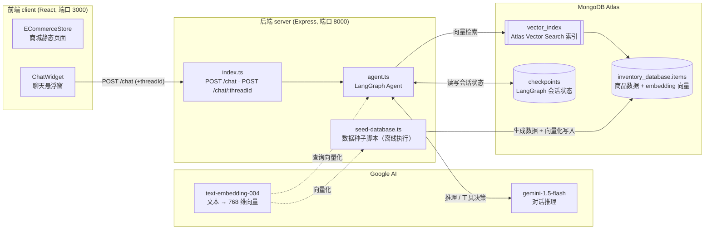
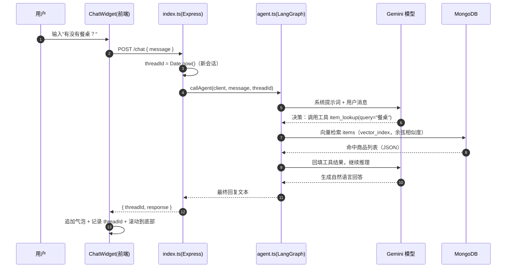
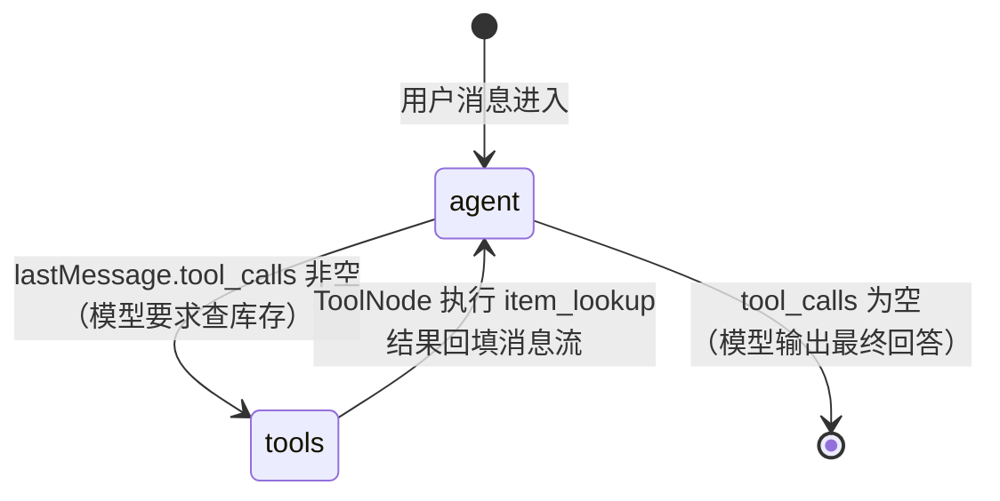

# Ecommerce-Chat-Helper 项目架构与代码说明文档

> 更新日期：2026-11-04
> 适用版本：当前 main 分支代码

---

## 目录

1. [项目简介](#1-项目简介)
2. [技术栈与依赖](#2-技术栈与依赖)
3. [目录结构](#3-目录结构)
4. [整体架构](#4-整体架构)
5. [核心流程详解](#5-核心流程详解)
6. [服务端模块详解（server）](#6-服务端模块详解server)
7. [前端模块详解（client）](#7-前端模块详解client)
8. [API 接口文档](#8-api-接口文档)
9. [数据库设计](#9-数据库设计)
10. [环境变量与启动指南](#10-环境变量与启动指南)
11. [已知问题与改进建议](#11-已知问题与改进建议)
12. [术语表](#12-术语表)

---

## 1. 项目简介

**Ecommerce-Chat-Helper** 是一个面向家具电商平台的 AI 智能客服系统。用户在商城页面的聊天窗中提问（如"有没有餐桌？"），后端基于 **Google Gemini 大模型 + LangGraph Agent 工作流** 理解意图，调用 `item_lookup` 工具对 **MongoDB Atlas 向量库** 做语义检索，并结合检索结果生成自然语言回答。

核心能力：

- **多轮对话**：通过 `thread_id` 在 MongoDB 中持久化会话状态，可跨请求延续上下文。
- **语义检索（RAG）**：商品文本经 Gemini `text-embedding-004`（768 维）向量化后存入 Atlas，查询时按余弦相似度检索；向量检索失败时回退到正则文本检索。
- **Agent 工具调用**：大模型自主决定是否调用 `item_lookup` 工具，LangGraph 负责"模型 ↔ 工具"循环编排。
- **容错处理**：API 限流指数退避重试、空库存提示、错误分类包装。

---

## 2. 技术栈与依赖

### 前端（client/）

| 技术 | 版本 | 用途 |
|---|---|---|
| React | ^19.1.1 | UI 框架（Hooks：useState / useEffect / useRef） |
| react-icons | ^5.5.0 | Font Awesome 图标组件 |
| react-scripts (CRA) | 5.0.1 | 开发服务器 / 构建工具链 |

### 服务端（server/）

| 技术 | 版本 | 用途 |
|---|---|---|
| Express | ^5.1.0 | HTTP 服务与路由 |
| MongoDB Driver | ^6.19.0 | 数据库连接 |
| LangChain Core | ^0.3.72 | 提示词模板、消息类型、工具定义、结构化输出解析 |
| LangChain Google GenAI | ^0.2.16 | Gemini 聊天模型 + Embedding 模型 |
| LangGraph | ^0.4.7 | Agent 状态图（StateGraph）编排 |
| langgraph-checkpoint-mongodb | ^0.1.0 | 会话状态持久化（MongoDBSaver） |
| langchain-mongodb | ^0.1.0 | MongoDB Atlas Vector Search 向量库封装 |
| Zod | ^3.25.76 | 工具入参 / 数据结构 Schema 校验 |
| dotenv / cors | - | 环境变量加载 / 跨域放行 |
| TypeScript + ts-node | - | 类型与直接运行 .ts |

---

## 3. 目录结构

```
Ecommerce-Chat-Helper/
├── client/                          # 前端（Create React App）
│   ├── public/
│   │   ├── index.html               # SPA 入口 HTML（含 <div id="root"> 挂载点）
│   │   └── manifest.json / favicon.ico ...
│   ├── src/
│   │   ├── index.js                 # React 渲染入口：createRoot → render <App/>
│   │   ├── index.css                # 全局基础样式（body 字体、margin 重置）
│   │   ├── App.js                   # 根组件：仅负责挂载 ECommerceStore
│   │   ├── App.css                  # 全部页面样式（聊天窗 + 商城页）
│   │   └── components/
│   │       ├── ECommerceStore.js    # 商城静态页面（头部/导航/Hero/页脚）
│   │       └── ChatWidget.js        # AI 客服聊天悬浮窗（唯一与后端交互处）
│   └── package.json                 # 前端依赖与脚本（npm start → :3000）
│
├── server/                          # 后端（Express + TypeScript）
│   ├── index.ts                     # 服务入口：MongoDB 连接 + 3 个 HTTP 路由
│   ├── agent.ts                     # LangGraph Agent：模型节点 + item_lookup 工具
│   ├── seed-database.ts             # 种子脚本：AI 生成 10 条家具数据并写入向量库
│   ├── .env                         # 环境变量（已被 .gitignore 排除）
│   ├── tsconfig.json                # TypeScript 编译配置
│   └── package.json                 # 后端依赖与脚本（dev / seed）
│
├── README.md                        # 英文项目说明（原仓库）
├── 项目架构与代码说明文档.md          # 本文档
└── .gitignore                       # 排除 server/.env、notes、server/node_modules/
```

---

## 4. 整体架构

### 4.1 架构总览图



### 4.2 分层职责

| 层 | 组件 | 职责 |
|---|---|---|
| 展示层 | `ECommerceStore.js` | 商城静态 UI，无业务逻辑 |
| 交互层 | `ChatWidget.js` | 收集用户输入、维护消息列表与 threadId、调用后端 API |
| 接口层 | `server/index.ts` | CORS/JSON 中间件、路由分发、错误兜底 |
| 智能层 | `server/agent.ts` | LangGraph 状态图：模型推理 ↔ 工具执行循环 |
| 工具层 | `item_lookup` 工具 | 向量检索（优先）+ 正则文本检索（回退） |
| 数据层 | MongoDB Atlas | 商品库（含向量）、向量索引、会话检查点 |
| 数据准备 | `seed-database.ts` | 用 Gemini 生成合成家具数据并建向量索引 |

---

## 5. 核心流程详解

### 5.1 首次对话流程（POST /chat）



### 5.2 多轮对话流程（POST /chat/:threadId）

- 前端检测到已有 `threadId`，改调 `/chat/:threadId`。
- 后端把 `thread_id` 传入 `configurable`，LangGraph 的 **MongoDBSaver 检查点** 从 MongoDB 恢复该会话的全部历史消息，模型"记得"之前聊过什么。
- 执行结束后新状态又被写回 MongoDB，实现跨请求的有状态对话。

> ⚠️ 注意：前端存在 threadId 被覆盖为 `undefined` 的缺陷，详见 [11. 已知问题](#11-已知问题与改进建议) 第 2 条。

### 5.3 Agent 内部循环（LangGraph 状态图）



关键机制：

| 机制 | 代码位置 | 说明 |
|---|---|---|
| 状态定义 | `GraphState`（`Annotation.Root`） | 只有一个 `messages` 字段，reducer 为 `x.concat(y)`：新旧消息拼接 |
| 条件路由 | `shouldContinue()` | 检查最后一条 AI 消息是否带 `tool_calls`，决定去 `tools` 节点还是结束 |
| 循环防护 | `recursionLimit: 15` | 防止"模型 ↔ 工具"无限循环 |
| 会话持久化 | `MongoDBSaver` checkpointer | 按 `thread_id` 读写检查点，多轮对话上下文得以延续 |
| 限流重试 | `retryWithBackoff()` | 捕获 HTTP 429，按 2^n 秒指数退避（上限 30s），最多 3 次 |

### 5.4 数据入库流程（seed-database.ts，离线脚本）

```
连接 Atlas → 建库建集合 → dropIndexes() → 创建 vector_index（768 维余弦）
    → Gemini(temperature 0.7) 生成 10 条家具数据（StructuredOutputParser 保证 JSON 结构）
    → 清空 items 集合
    → 每条记录 createItemSummary() 拼接可读摘要（名称/描述/品牌/产地/分类/评价/价格/备注）
    → MongoDBAtlasVectorSearch.fromDocuments() 自动调用 text-embedding-004 生成 768 维向量
      并以 embedding_text（原文）+ embedding（向量）双字段写入 items
```

---

## 6. 服务端模块详解（server）

### 6.1 index.ts — HTTP 服务入口（94 行）

| 区块 | 说明 |
|---|---|
| 中间件 | `cors()` 全放行跨域；`express.json()` 解析 JSON 请求体 |
| 连接初始化 | `startServer()` 内 `client.connect()` + `ping` 验证，失败则 `process.exit(1)` |
| `GET /` | 健康检查，返回字符串 `LangGraph Agent Server` |
| `POST /chat` | 新会话：`threadId = Date.now().toString()`，调 `callAgent`，返回 `{ threadId, response }` |
| `POST /chat/:threadId` | 续会话：从 URL 取 threadId，返回 `{ response }` |
| 端口 | `process.env.PORT \|\| 8000` |

### 6.2 agent.ts — LangGraph Agent（268 行，核心）

1. **retryWithBackoff(fn, maxRetries=3)**：通用指数退避重试，仅对 `error.status === 429` 生效。
2. **GraphState**：`Annotation.Root({ messages })`，reducer 拼接消息数组。
3. **item_lookup 工具**（`tool()` + zod schema `{ query: string, n?: number=10 }`）：
   - 先 `countDocuments()` 判空，空库直接返回友好 JSON；
   - 构造 `MongoDBAtlasVectorSearch`（`vector_index` / `embedding_text` / `embedding`），执行 `similaritySearchWithScore(query, n)`；
   - 向量检索无结果时回退：对 `item_name / item_description / categories / embedding_text` 四字段做 `$regex` 忽略大小写查询；
   - 所有结果以 JSON 字符串返回给模型；异常也被捕获并包装为 JSON（不中断 Agent 循环）。
4. **模型**：`ChatGoogleGenerativeAI`（gemini-1.5-flash，temperature 0，自管重试）`.bindTools(tools)`。
5. **callModel**：`ChatPromptTemplate`（系统提示：家具店客服角色 + 强制使用工具的规则 + 当前时间占位符）+ `MessagesPlaceholder("messages")`，外包 retryWithBackoff。
6. **工作流**：`StateGraph` — `__start__ → agent`；`agent --shouldContinue--> tools / __end__`；`tools → agent`。
7. **执行**：`compile({ checkpointer: MongoDBSaver })` → `invoke({ messages: [HumanMessage] }, { configurable: { thread_id } })` → 取最后一条消息的 `content` 返回。
8. **错误包装**：429 → "限流，请稍后再试"；401 → "鉴权失败"；其余 → `Agent failed: <msg>`。

### 6.3 seed-database.ts — 数据种子脚本（220 行）

| 函数 | 职责 |
|---|---|
| `setupDatabaseAndCollection()` | 确保 `inventory_database.items` 集合存在 |
| `createVectorSearchIndex()` | `dropIndexes()` 后创建 `vector_index`（vector 类型、`embedding` 字段、768 维、cosine） |
| `generateSyntheticData()` | Gemini 生成 10 条家具记录；`StructuredOutputParser.fromZodSchema(z.array(itemSchema))` 强制输出结构并解析为 `Item[]` |
| `createItemSummary(item)` | 拼接"名称+描述+品牌+产地+分类+评价+价格+备注"为一段可检索文本 |
| `seedDatabase()` | 主流程：连接 → 建集合 → 建索引 → 清空 → 生成 → `fromDocuments` 逐条向量化入库 → 关闭连接 |

`itemSchema`（Zod）字段：`item_id`、`item_name`、`item_description`、`brand`、`manufacturer_address{street,city,state,postal_code,country}`、`prices{full_price,sale_price}`、`categories[]`、`user_reviews[{review_date,rating,comment}]`、`notes`。

---

## 7. 前端模块详解（client）

> 所有前端源码已补充逐行中文注释，以下为要点摘要。

### 7.1 index.js — 渲染入口
`ReactDOM.createRoot(#root)` 将 `<App/>` 包在 `React.StrictMode` 中渲染。

### 7.2 App.js — 根组件
仅渲染 `<ECommerceStore/>`。注意：容器类名是 `app`（小写），而 App.css 中定义的是 `.App`（大写），该样式规则实际不生效。

### 7.3 ECommerceStore.js — 商城静态页
纯展示组件：顶栏（logo/搜索框/账户/收藏角标 3/购物车角标 2）、七项分类导航（Home 激活）、Hero 夏季促销横幅、四栏页脚 + 版权。页脚 `{new Date().getFullYear}` 缺少调用括号 `()`，会把函数源码渲染成文本。

### 7.4 ChatWidget.js — AI 客服聊天窗（核心交互）

| 状态/引用 | 作用 |
|---|---|
| `isOpen` | 窗口展开/收起（收起时显示右下角圆形按钮） |
| `messages` | `{ text, isAgent }[]` 消息气泡列表 |
| `inputValue` | 受控输入框内容（空则禁用发送按钮） |
| `threadId` | 会话标识：null → `POST /chat`；有值 → `POST /chat/:threadId` |
| `messageEndRef` | 列表底部锚点，`useEffect` 中 `scrollIntoView({behavior:'smooth'})` 自动滚底 |

发送逻辑 `handleMessage`：
1. `preventDefault` 阻止刷新 → 用户消息入列 → 清空输入框；
2. 按 threadId 选择端点，`fetch` POST JSON `{ message }`；
3. `!response.ok` 抛错 → AI 回复入列 → 记录 `data.threadId`；
4. 失败仅 `console.log`，无用户可见提示。

### 7.5 App.css / index.css — 样式
- `index.css`：body 字体栈与抗锯齿。
- `App.css`：三大区块——基础重置、聊天悬浮窗（`.chat-widget-container` 由圆形按钮 60px 过渡到 350×500 窗口；`.message-bot` 左灰 / `.message-user` 右紫气泡）、商城页（吸顶 header、胶囊搜索框、导航底部指示条、渐变 Hero、Grid 自适应页脚）。每条声明均附中文行内注释。

---

## 8. API 接口文档

Base URL：`http://localhost:8000`

### GET /
健康检查。

```text
响应 200: "LangGraph Agent Server"
```

### POST /chat — 开始新会话

```bash
curl -X POST -H "Content-Type: application/json" \
  -d '{"message": "Do you have any dining tables?"}' \
  http://localhost:8000/chat
```

| 项 | 说明 |
|---|---|
| 请求体 | `{ "message": string }` |
| 成功响应 | `{ "threadId": "1730000000000", "response": "AI 回复文本" }` |
| 失败响应 | 500 `{ "error": "Internal server error" }` |

### POST /chat/:threadId — 继续既有会话

| 项 | 说明 |
|---|---|
| 路径参数 | `threadId`：首次调用返回的线程 ID |
| 请求体 | `{ "message": string }` |
| 成功响应 | `{ "response": "AI 回复文本" }`（注意：**不含 threadId**） |
| 失败响应 | 500 `{ "error": "Internal server error" }` |

后端错误语义（由 agent.ts 包装后经 index.ts 返回 500）：限流 / 鉴权失败 / 其它异常，`message` 会体现在服务端日志中。

---

## 9. 数据库设计

### 9.1 inventory_database.items（商品集合）

| 字段 | 类型 | 说明 |
|---|---|---|
| `item_id` | string | 商品唯一 ID |
| `item_name` / `item_description` | string | 名称 / 描述 |
| `brand` | string | 品牌 |
| `manufacturer_address` | object | `{street, city, state, postal_code, country}` |
| `prices` | object | `{full_price, sale_price}` 原价 / 促销价 |
| `categories` | string[] | 分类标签 |
| `user_reviews` | array | `{review_date, rating, comment}` 用户评价 |
| `notes` | string | 备注 |
| `embedding_text` | string | `createItemSummary()` 生成的可检索摘要文本（textKey） |
| `embedding` | number[768] | text-embedding-004 生成的向量（embeddingKey） |

### 9.2 vector_index（Atlas Vector Search 索引）

```json
{
  "name": "vector_index",
  "type": "vectorSearch",
  "definition": {
    "fields": [{
      "type": "vector",
      "path": "embedding",
      "numDimensions": 768,
      "similarity": "cosine"
    }]
  }
}
```

### 9.3 会话检查点（LangGraph Checkpoints）

`MongoDBSaver({ client, dbName: "inventory_database" })` 会在同一数据库中自动创建 `checkpoints` 等集合，按 `thread_id` 存储每轮对话的完整消息状态，是实现多轮记忆的关键。

---

## 10. 环境变量与启动指南

### 10.1 环境变量（server/.env）

```env
MONGODB_ATLAS_URI=mongodb+srv://<user>:<pass>@<cluster>/...
GOOGLE_API_KEY=你的_Gemini_API_Key
```

- `MONGODB_ATLAS_URI`：MongoDB Atlas 控制台获取（需放行本机 IP）。
- `GOOGLE_API_KEY`：Google Cloud Console 启用 Generative Language API 后创建。
- 该文件已列入 `.gitignore`，不会提交。

### 10.2 启动步骤

```bash
# 1) 后端
cd server
npm install
npm run seed     # 生成 10 条合成家具数据并写入向量库（需可访问 Gemini）
npm run dev      # 启动 Express 服务（默认 :8000）
                 # 注意：package.json 只有 dev / seed 脚本，没有 README 所写的 npm start

# 2) 前端（另开终端）
cd client
npm install
npm start        # CRA 开发服务器（默认 :3000）
```

浏览器打开 `http://localhost:3000`，点击右下角紫色气泡即可与 AI 客服对话。

---

## 11. 已知问题与改进建议

### 前端

| # | 问题 | 位置 | 建议 |
|---|---|---|---|
| 1 | 会话丢失缺陷：继续会话接口只返回 `{response}`，`setThreadId(data.threadId)` 会把 threadId 覆盖为 `undefined`，导致下一轮误走 `/chat` 新建会话、上下文清零 | ChatWidget.js | 改为 `if (data.threadId) setThreadId(data.threadId)` |
| 2 | 输入框使用 `class ="message-input"` 而非 `className`（React 规范） | ChatWidget.js | 改为 `className` |
| 3 | 页脚 `{new Date().getFullYear}` 缺少调用括号，页面显示函数源码 | ECommerceStore.js | 改为 `{new Date().getFullYear()}` |
| 4 | `App.js` 容器类名 `app` 与 CSS 选择器 `.App` 不匹配，样式永不生效 | App.js / App.css | 统一命名 |
| 5 | 导入了未使用的 `use`（React 实验性 API） | ChatWidget.js | 移除 |
| 6 | 后端地址硬编码 `http://localhost:8000` | ChatWidget.js | 使用 `process.env.REACT_APP_API_URL` |
| 7 | 请求失败仅 `console.log`，用户无感知 | ChatWidget.js | 追加错误提示气泡 |
| 8 | 残留多处 `console.log` 调试输出 | ChatWidget.js | 上线前清理 |

### 服务端

| # | 问题 | 位置 | 建议 |
|---|---|---|---|
| 1 | `POST /chat/:threadId` 响应不含 threadId（问题 1 的根因） | index.ts | 响应中回传 threadId |
| 2 | CORS 全放行、无鉴权、无限流，直接暴露 LLM 成本 | index.ts | 限制 origin、加 API Key / 速率限制 |
| 3 | `createVectorSearchIndex` 中 `dropIndexes()` 会删除集合上所有索引 | seed-database.ts | 仅按名删除重建 |
| 4 | 文本回退检索用 `$regex` 直接拼接用户输入，特殊正则字符会报错或全表扫描 | agent.ts | 转义输入或改用 `$text` / Atlas Search |
| 5 | 每次工具调用都执行 `countDocuments` + 抽样 3 条打印（调试开销） | agent.ts | 降级为环境变量开关 |
| 6 | `retryWithBackoff` 只处理 429，网络抖动等其他瞬时错误不重试 | agent.ts | 扩大可重试错误范围 |
| 7 | 文档与脚本不一致：README 写 `npm start`，实际脚本为 `npm run dev` | README.md / package.json | 统一脚本名 |
| 8 | `fromDocuments` 逐条插入，10 条数据无碍，数据量大时应批量 | seed-database.ts | 批量写入 |

---

## 12. 术语表

| 术语 | 含义 |
|---|---|
| RAG（检索增强生成） | 先从知识库检索相关内容，再交由大模型生成回答的模式；本项目 = 向量检索 + Gemini |
| Embedding（嵌入向量） | 把文本映射为高维数值向量，语义相近的文本向量距离更近；本项目用 text-embedding-004，768 维 |
| Vector Search（向量检索） | 按向量相似度（此处余弦相似度）查找最相近的文档 |
| Tool Calling（工具调用） | 大模型输出结构化"函数调用请求"，由应用执行后把结果回填给模型继续推理 |
| LangGraph StateGraph | 以有向图编排 LLM 应用的框架；节点=处理步骤，边/条件边=流转规则 |
| Reducer | LangGraph 状态合并函数，决定新值如何与旧值合并（此处为数组 concat） |
| Checkpointer（检查点） | LangGraph 的状态持久化机制；按 thread_id 存取会话，实现多轮记忆与恢复 |
| thread_id | 会话线程标识，串联一次完整对话的所有状态 |
| temperature | 模型采样随机性：0≈确定输出；0.7≈较有创造性（用于造数据） |
| 指数退避（Exponential Backoff） | 失败后按 2^n 秒递增等待再重试，缓解限流（429） |

---

*本文档与逐行中文注释配套：服务端 3 个 TS 文件原已带英文逐行注释，前端 JS/CSS 已由本次更新补全中文注释。*
